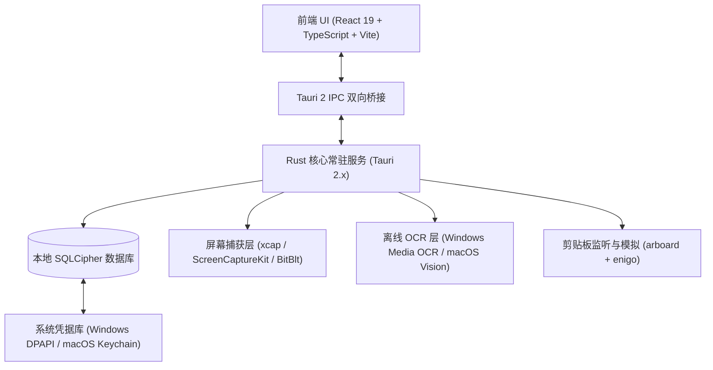

# dudu · 桌面效率工作台

<p align="center">
  
</p>

<p align="center">
  <strong>截图 · 翻译 · 剪贴板历史一体化 桌面效率工具</strong>
</p>

<p align="center">
  <a href="https://github.com/muzi86754781/dudu/actions"></a>
  <a href="https://github.com/muzi86754781/dudu/releases"></a>
  
  
  
</p>

---

## 1. 产品定位与核心价值

**dudu** 是一款面向知识工作者与开发者的跨平台桌面常驻效率工具。它将日常高频使用的 **截图标注**、**文本/划词翻译与 OCR**、**剪贴板历史管理** 深度整合为一体。

- **极速响应**：全局快捷键随时唤起，即开即用、即用即走，核心响应时间控制在 200ms 以内。
- **本地优先**：所有复制的历史内容、API 密钥与翻译缓存均采用 **SQLCipher** 硬件级加密留存在本机，绝不上云、零行为追踪。
- **开箱即用**：无需繁琐配置，内置系统级离线 OCR 与免配置翻译引擎。

---

## 2. 核心功能矩阵

### 📸 截图与标注工作台
- **多种采集模式**：
  - **区域截图**（默认 `Ctrl+Alt+A` / `Cmd+Shift+A`）：拖拽精准选区，实时显示物理像素尺寸与选区提示。
  - **窗口截图**（默认 `Ctrl+Alt+W` / `Cmd+Shift+W`）：智能识别鼠标悬停的各应用窗口，点击即可捕获。
  - **全屏截图**（默认 `Ctrl+Alt+F` / `Cmd+Shift+F`）：捕获活跃显示器完整画面。
  - **延时截图**：支持 3s / 5s / 10s 倒计时截图，适合捕获临时下拉菜单或悬停 Tooltip。
- **丰富标注工具套件**：
  - 矩形（R）、椭圆（E）、直线（L）、箭头（A）、自由手绘画笔（P）。
  - 文字标注（T，支持多行输入与自适应字号）、步骤序号（N，自动 1/2/3 递增）。
  - 敏感信息马赛克涂抹（M）与半透明矩形高亮（H）。
  - 支持多达 20 步的撤销（Ctrl/Cmd+Z）与重做（Ctrl/Cmd+Shift+Z）。
- **即时操作面板**：
  - 一键复制图片到剪贴板、另存为文件（PNG / JPG / WebP）、复制为 Base64 或 Markdown 图片语法。
  - **屏幕钉（贴图）**：将截图置顶钉在屏幕前端，支持缩放、透明度调节、拖拽移动与双击编辑。
  - **屏幕取色器**（`Ctrl+Alt+C` / `Cmd+Shift+C`）：光标悬浮实时显示 9×9 放大镜网格，呈现 HEX、RGB 与十进制数值，点击即刻复制，记录最近 10 次取色历史。
  - **二维码识别**：截图内自动检测二维码，一键提取链接/文本，支持直接在浏览器中打开。
  - **长截图拼接**：支持多屏连续切片拼入长图队列，并在完成后一键合并输出。

### 🌐 翻译与 OCR 识别
- **多元触发**：
  - **划词翻译**（默认 `Ctrl+Alt+D` / `Cmd+D`）：在任意软件选中文字后按下快捷键，自动带入原文并翻译。
  - **截图 OCR**（默认 `Ctrl+Alt+S` / `Cmd+S`）：框选屏幕任意区域，通过系统原生离线引擎识别提取文本。
  - **输入翻译**（默认 `Ctrl+Alt+T` / `Cmd+A`）：主面板手动输入或粘贴长文本翻译。
- **多引擎支持与缓存**：
  - 默认接入 Google 翻译（免费通用免配）、DeepL Free、百度翻译、有道智云，支持用户填入自有 API 密钥。
  - 24 小时本地 SQLite 缓存策略，相同文本秒级返回，减少不必要的网络请求。
- **程序员效率增强**：
  - **代码命名拆分与转换**：一键将 `camelCase`、`PascalCase`、`snake_case`、`kebab-case`、`SCREAMING_SNAKE` 互转互拆。
  - **英汉简明词典**：单词查询返回准确音标、词性、中文释义与代码例句。
  - **语音朗读（TTS）**：支持译文发音朗读。

### 📋 剪贴板历史管理
- **全格式自动捕获**：
  - 自动记录复制的纯文本、代码、富文本与图片，图片以缩略图形式安全入库。
  - **去重与合并**：内容相同不重复记录，5 分钟内重复操作自动合并。
  - **隐私白名单与忽略过滤**：默认自动识别并跳过 1Password、Bitwarden、KeePass 等密码管理器；支持用户自定义敏感词黑名单。
- **便捷调用与键盘导航**：
  - 全局快捷键呼出面板（默认 `Ctrl+Alt+V` / `Cmd+Shift+V`）。
  - 方向键选择，回车（Enter）自动写入系统剪贴板并模拟粘贴到当前焦点窗口。
  - 数字键 `Alt + 1~9` 快速选取对应条目。
  - **连续合并粘贴（Serial Paste）**：支持勾选多个历史片段，按顺序组合（换行符、Tab 制表符、空格分隔）一次性批量粘贴。
- **检索与备份**：
  - 毫秒级模糊检索，关键词高亮展示。
  - 收藏片段固定置顶，不会被历史容量规则淘汰。
  - 支持将全部数据与配置一键导出为 JSON 备份或从备份文件恢复。

---

## 3. 全局默认快捷键速查表

| 功能操作 | Windows 快捷键 | macOS 快捷键 | 可否自定义 |
| :--- | :--- | :--- | :---: |
| **区域截图** | <kbd>Ctrl</kbd> + <kbd>Alt</kbd> + <kbd>A</kbd> | <kbd>Cmd</kbd> + <kbd>Shift</kbd> + <kbd>A</kbd> | 是 |
| **窗口截图** | <kbd>Ctrl</kbd> + <kbd>Alt</kbd> + <kbd>W</kbd> | <kbd>Cmd</kbd> + <kbd>Shift</kbd> + <kbd>W</kbd> | 是 |
| **全屏截图** | <kbd>Ctrl</kbd> + <kbd>Alt</kbd> + <kbd>F</kbd> | <kbd>Cmd</kbd> + <kbd>Shift</kbd> + <kbd>F</kbd> | 是 |
| **划词翻译** | <kbd>Ctrl</kbd> + <kbd>Alt</kbd> + <kbd>D</kbd> | <kbd>Cmd</kbd> + <kbd>D</kbd> | 是 |
| **截图 OCR** | <kbd>Ctrl</kbd> + <kbd>Alt</kbd> + <kbd>S</kbd> | <kbd>Cmd</kbd> + <kbd>S</kbd> | 是 |
| **输入翻译面板** | <kbd>Ctrl</kbd> + <kbd>Alt</kbd> + <kbd>T</kbd> | <kbd>Cmd</kbd> + <kbd>A</kbd> | 是 |
| **剪贴板历史** | <kbd>Ctrl</kbd> + <kbd>Alt</kbd> + <kbd>V</kbd> | <kbd>Cmd</kbd> + <kbd>Shift</kbd> + <kbd>V</kbd> | 是 |
| **屏幕取色器** | <kbd>Ctrl</kbd> + <kbd>Alt</kbd> + <kbd>C</kbd> | <kbd>Cmd</kbd> + <kbd>Shift</kbd> + <kbd>C</kbd> | 是 |

*注：若快捷键与系统或微信、QQ 等现有软件冲突，可在「偏好设置 → 全局快捷键」中重新自定义，保存时会自动进行冲突检测。*

---

## 4. 技术架构与安全性



- **底层引擎**：Tauri 2.x + Rust 2021 Edition。常驻内存占用严格保持在 150MB 以下。
- **存储加密**：SQLCipher 数据库通过系统安全凭据管理（Windows Credential Manager / macOS Keychain）派发动态密钥，实现透明加密。
- **权限需求说明**：
  - **macOS**：初次运行截图需授予「屏幕录制」权限；模拟快捷键输入需授予「辅助功能」权限。
  - **Windows**：开机自启通过标准注册表 Run 项注册，可自由开关。

---

## 5. 本地开发与构建

### 运行环境准备
- **Node.js**：v20 或更高版本
- **Rust**：1.78 或更高版本
- **Windows**：Visual Studio C++ 生成工具 + NASM + Strawberry Perl（用于编译 OpenSSL/SQLCipher）
- **macOS**：Xcode Command Line Tools（包含 swiftc）

### 开发命令

```bash
# 1. 安装前端依赖
npm install

# 2. 运行前端单元测试
npm test

# 3. 启动开发模式（热重载）
npm run dev

# 4. 前端构建检查
npm run build
```

---

## 6. GitHub Actions 自动化编译发布

本项目已配置完善的 GitHub Actions 流水线（`.github/workflows/build-and-release.yml`）。
在推送代码至 `main` 分支或创建 `v*` Tag 时，GitHub Actions 会自动编译并打包全平台安装包：

- **Windows x64**：
  - `dudu-x64-setup.exe`（NSIS 快速安装器）
  - `dudu.msi`（企业级 Windows Installer）
- **macOS (Apple Silicon arm64)**：
  - `dudu-aarch64.dmg`
- **macOS (Intel x86_64)**：
  - `dudu-x64.dmg`

编译完成后，安装包将自动挂载至该次 Workflow Run 的 **Artifacts**，并同步自动生成对应的 **GitHub Release** 版本。

---

## 7. 许可证

本项目基于 [MIT License](LICENSE) 开源。
